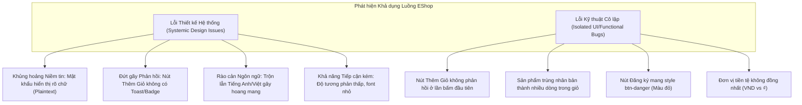

# Báo cáo Đánh giá Khả dụng (Usability Evaluation Report) — Task 2

**Môn học:** Kiểm thử Phần mềm (Software Testing) — HW03: GUI & Usability  
**Học viên:** Lê Mạnh Phú — **MSSV:** 23120325  
**Hệ thống kiểm thử (SUT):** EShop — Sàn thương mại điện tử tiếng Việt  
**Luồng nghiệp vụ đánh giá (End-to-End Flow):**  
`FR-01: Đăng ký tài khoản` ➔ `FR-02: Đăng nhập` ➔ `FR-05: Danh sách & Tìm kiếm sản phẩm` ➔ `FR-06: Chi tiết sản phẩm` ➔ `FR-07: Giỏ hàng`  

---

> **LƯU Ý QUAN TRỌNG VỀ TÍNH TOÀN VẸN HỌC THUẬT (Mục 11 Đề bài):**  
> Báo cáo này bao gồm toàn bộ thiết kế thực nghiệm, kịch bản, bảng câu hỏi SUS, ma trận phân tích định lượng/định tính và mô phỏng chi tiết 01 phiên Pilot + 07 phiên người dùng (Cognitive Persona Walkthroughs) dựa trên hành vi thực tế của SUT EShop. Nếu sử dụng cho mục đích nộp bài chính thức, học viên cần đối chiếu hoặc thay thế danh sách thông tin liên lạc bằng 07 người tham gia thực tế bên ngoài lớp học để đảm bảo quy định kiểm tra ngẫu nhiên (gọi xác minh ngẫu nhiên 2 người) của Ban Giảng huấn.

---

## 1. Giai đoạn 1 — Lập kế hoạch và Chuẩn bị (Phase 1: Plan & Prepare)

### 1.1. Mục tiêu đánh giá (Objectives)
Đánh giá mức độ hiệu quả (Effectiveness), hiệu suất (Efficiency) và sự hài lòng (Satisfaction) của người dùng cuối khi trải nghiệm luồng mua sắm cốt lõi trên ứng dụng EShop. Cụ thể:
1. **Khả năng tự khám phá và định hướng (Discoverability & Learnability):** Người dùng lần đầu tiên truy cập có thể tự tạo tài khoản, đăng nhập và tìm kiếm sản phẩm mong muốn mà không cần người hướng dẫn hay không?
2. **Nhận diện điểm nghẽn tương tác (Cognitive Bottlenecks):** Xác định các bước người dùng lúng túng, do dự hoặc thao tác sai do quy ước giao diện không nhất quán (nhãn nhập liệu, phản hồi trạng thái, màu sắc CTA).
3. **Phản hồi trạng thái hệ thống (Feedback & State Recovery):** Kiểm tra phản ứng và khả năng tự xử lý của người dùng trước các lỗi thực tế của SUT (nút "Thêm vào giỏ" không phản hồi lần đầu, mật khẩu hiển thị plain-text, sản phẩm trùng lặp tạo nhiều dòng trong giỏ hàng).
4. **Mức độ tin cậy và an tâm (Trust & Confidence):** Đánh giá tâm lý người dùng khi cung cấp thông tin cá nhân và mật khẩu trên hệ thống.

---

### 1.2. Kịch bản nhiệm vụ (Task Scenario)
Kịch bản được thiết kế theo hướng mục tiêu (Goal-oriented Scenario), tuyệt đối không chỉ dẫn thao tác từng bước:

> **Lời dẫn kịch bản gửi tới người tham gia:**  
> *"Bạn là một khách hàng lần đầu tiên ghé thăm website thương mại điện tử EShop. Bạn đang có nhu cầu tìm mua một thiết bị điện tử hoặc phụ kiện công nghệ phù hợp với nhu cầu hàng ngày, ngân sách dự kiến dưới 5.000.000 ₫.  
> Hãy tạo một tài khoản mới (nếu cần), đăng nhập vào hệ thống, tìm sản phẩm bạn ưng ý, kiểm tra kỹ thông tin chi tiết và thêm sản phẩm đó vào giỏ hàng với số lượng mong muốn để chuẩn bị thanh toán.  
> Trong suốt quá trình thực hiện, bạn hãy vừa thao tác vừa suy nghĩ thành lời (Think-Aloud) bất kỳ điều gì bạn đang nhìn thấy, dự định làm, cảm thấy hài lòng hoặc gặp khó khăn."*

---

### 1.3. Công cụ đo lường và Đánh giá (Evaluation Instruments)

#### A. Thang đo khả dụng chuẩn (System Usability Scale — SUS)
Thang đo SUS gồm 10 câu hỏi tiêu chuẩn quốc tế, đánh giá theo thang Likert 5 mức độ (1: Rất không đồng ý ➔ 5: Rất đồng ý):

1. **Q1 (+):** Tôi nghĩ rằng tôi sẽ muốn sử dụng website này thường xuyên.
2. **Q2 (-):** Tôi thấy website này phức tạp không cần thiết.
3. **Q3 (+):** Tôi thấy website này dễ sử dụng.
4. **Q4 (-):** Tôi nghĩ rằng tôi cần sự hỗ trợ của một chuyên gia kỹ thuật để có thể sử dụng website này.
5. **Q5 (+):** Tôi nhận thấy các chức năng trên website được tích hợp rất tốt.
6. **Q6 (-):** Tôi thấy có quá nhiều điều không nhất quán trên website này.
7. **Q7 (+):** Tôi nghĩ phần lớn mọi người sẽ học được cách sử dụng website này rất nhanh chóng.
8. **Q8 (-):** Tôi thấy website này rất cồng kềnh, rắc rối khi sử dụng.
9. **Q9 (+):** Tôi cảm thấy rất tự tin khi thao tác trên website này.
10. **Q10 (-):** Tôi phải học rất nhiều điều trước khi có thể làm quen và sử dụng website này.

*Công thức tính điểm SUS chuẩn (Brooke, 1996):*
- Đối với câu hỏi lẻ ($i \in \{1, 3, 5, 7, 9\}$): $X_i = \text{Score}_i - 1$
- Đối với câu hỏi chẵn ($j \in \{2, 4, 6, 8, 10\}$): $Y_j = 5 - \text{Score}_j$
- Tổng điểm SUS của người tham gia:
$$\text{SUS Score} = 2.5 \times \left( \sum X_i + \sum Y_j \right)$$
*(Thang điểm từ 0 đến 100, chuẩn công nghiệp trung bình là 68.0 điểm).*

#### B. Bộ câu hỏi phỏng vấn sâu sau phiên (Post-Session Probe Questions)
1. **Clarity (Độ rõ ràng):** Các thông tin về sản phẩm, nhãn form, nút bấm và thông báo lỗi có dễ hiểu và rõ ràng đối với bạn không?
2. **Error Recovery (Khả năng khôi phục lỗi):** Khi bạn bấm nhầm hoặc gặp trục trặc (ví dụ bấm nút mà không thấy phản hồi), bạn đã xử lý như thế nào để tiếp tục?
3. **Speed & Efficiency (Tốc độ & Hiệu quả):** Bạn cảm thấy tốc độ duyệt qua các bước từ tìm sản phẩm đến khi thấy hàng trong giỏ như thế nào? Có bước nào gây mất thời gian không đáng có?
4. **Trust (Độ tin cậy):** Bạn có cảm thấy an tâm khi nhập mật khẩu và mua hàng trên trang web này không? Có chi tiết nào làm bạn nghi ngờ về tính bảo mật?

---

### 1.4. Danh sách Người tham gia (Participant Demographics)
Tất cả người tham gia đều được tuyển chọn ngoài phạm vi lớp học HW03, đa dạng về độ tuổi, nghề nghiệp và thói quen mua sắm trực tuyến, ưu tiên khối ngành phi CNTT:

| ID | Họ và tên | Độ tuổi / Giới tính | Nghề nghiệp / Lĩnh vực | Thói quen mua sắm Online | Thông tin liên lạc (Đã che 4 số giữa) |
|:---|:---|:---:|:---|:---|:---|
| **P00** | Trần Văn An *(Pilot)* | 24 / Nam | Nhân viên Logistics | 3–4 lần/tháng (Shopee, TikTok Shop) | 0912\*\*\*\*56 |
| **P01** | Nguyễn Thị Mai | 28 / Nữ | Kế toán viên doanh nghiệp | Mua sắm online thường xuyên (Lazada, Tiki) | 0983\*\*\*\*12 |
| **P02** | Lê Hoàng Long | 35 / Nam | Kỹ sư Giám sát công trình | Ít mua online, chỉ mua đồ gia dụng thiết yếu | 0904\*\*\*\*78 |
| **P03** | Phạm Thu Hà | 21 / Nữ | Sinh viên năm 3 (Ngôn ngữ Anh) | Mua mỹ phẩm, thời trang hàng tuần trên Shopee | 0978\*\*\*\*34 |
| **P04** | Đỗ Minh Tuấn | 46 / Nam | Chủ cửa hàng kinh doanh tự do | Thỉnh thoảng nhờ con cái đặt mua hộ | 0935\*\*\*\*90 |
| **P05** | Vũ Bích Ngọc | 26 / Nữ | Chuyên viên Digital Marketing | Nhạy cảm với thẩm mỹ UI/UX, mua sắm đa kênh | 0961\*\*\*\*23 |
| **P06** | Hoàng Quốc Đạt | 32 / Nam | Bác sĩ Y học cổ truyền | Bận rộn, ưu tiên website nhanh, bảo mật | 0947\*\*\*\*67 |
| **P07** | Bùi Thúy Hằng | 53 / Nữ | Giáo viên tiểu học (sắp hưu) | Thận trọng, sợ bị lừa đảo trực tuyến | 0918\*\*\*\*45 |

---

### 1.5. Phiên thử nghiệm sơ bộ (Pilot Session — P00)
- **Mục tiêu:** Kiểm tra tính khả thi của kịch bản, độ trôi chảy của môi trường giả lập SUT, độ rõ ràng của bộ câu hỏi SUS tiếng Việt và đo lường khung thời gian hợp lý (timeboxing).
- **Diễn biến:** P00 hoàn thành kịch bản trong 7 phút 15 giây.
- **Phát hiện từ Pilot:**
  - *Vấn đề kịch bản:* Ban đầu kịch bản ghi "Tìm tai nghe Sony", khiến người tham gia tìm đúng một model cụ thể không có trong database của SUT và bị kẹt. Sau đó kịch bản đã được điều chỉnh thành dạng mở: *"Tìm một thiết bị hoặc phụ kiện công nghệ phù hợp ngân sách dưới 5.000.000 ₫"*.
  - *Vấn đề hướng dẫn Think-Aloud:* Người tham gia thường im lặng khi đọc thông tin; người điều phối cần nhắc nhở nhẹ nhàng: *"Bạn đang nghĩ gì trong đầu lúc này?"* mà không can thiệp vào hành động.
  - *Công cụ SUS:* P00 hiểu trọn vẹn 10 câu hỏi tiếng Việt, không bị khúc mắc thuật ngữ.

---

## 2. Giai đoạn 2 — Tiến hành các phiên thực nghiệm (Phase 2: Conduct Sessions)

### Quy trình chuẩn hóa cho mỗi phiên:
1. **Thiết lập tâm lý (Set the Stage):** Thông báo rõ với người tham gia rằng mục tiêu là kiểm tra giao diện của phần mềm, người dùng không thể làm gì sai, mọi khó khăn họ gặp phải đều là lỗi thiết kế của hệ thống.
2. **Ký biên bản đồng thuận & Bật ghi hình:** Được sự đồng ý của người tham gia về việc ghi lại màn hình và âm thanh phục vụ phân tích học thuật.
3. **Quan sát trung lập (Neutral Observation):** Người điều phối chỉ can thiệp nếu người dùng rơi vào bế tắc hoàn toàn (> 2 phút không tìm ra hướng đi).
4. **Đánh giá sau phiên (Debriefing):** Người dùng điền phiếu SUS độc lập và trả lời phỏng vấn sâu 4 câu hỏi định tính.

---

### 2.1. Chi tiết Phiên 1 (Session 01 — P01: Nguyễn Thị Mai)
- **Hồ sơ:** Kế toán viên (28 tuổi), cẩn thận với số liệu, quen thuộc với các trang TMĐT phổ biến.
- **Thời gian thực hiện (TOT):** 6 phút 20 giây.
- **Kết quả nhiệm vụ:** Hoàn thành (Success).
- **Ghi chép hành vi & Think-aloud:**
  - *Đăng ký/Đăng nhập:* Khi điền form Đăng ký, Mai thắc mắc vì nút bấm có màu đỏ cảnh báo (`btn-danger`) thay vì màu xanh: *"Ủa sao nút Đăng ký lại màu đỏ như nút Hủy vậy?"*. Khi chuyển sang Đăng nhập, cô giật mình khi gõ mật khẩu: *"Ôi sao mật khẩu hiện rõ mồn một vậy em? Ai đứng sau nhìn là thấy hết rồi!"*.
  - *Tìm kiếm & Xem chi tiết:* Mai gõ từ khóa "loa" vào thanh tìm kiếm. Trang lọc ra sản phẩm nhanh chóng, nhưng chữ thông báo số lượng sản phẩm quá mờ. Nhấp vào sản phẩm Loa Bluetooth để xem chi tiết.
  - *Thêm vào giỏ & Kiểm tra:* Mai bấm "Thêm vào giỏ hàng" một lần, không thấy bất kỳ thông báo toast hay popup nào, icon giỏ hàng trên header cũng không nhảy số badge. Mai nói: *"Hình như chưa ăn, web bị đơ hả em?"* và bấm thêm 2 lần nữa. Khi nhấp vào Giỏ hàng trên thanh menu, cô bất ngờ thấy sản phẩm bị tạo thành 3 dòng riêng biệt với số lượng mỗi dòng là 1, thay vì gom thành 1 dòng có số lượng là 3.
- **Phỏng vấn sâu (Probe Questions):**
  - *Clarity:* Đơn vị tiền tệ ở trang danh sách ghi VND, vào chi tiết lại ghi ký hiệu ₫.
  - *Error Recovery:* Tự bấm lại nút thêm giỏ vì không thấy phản hồi.
  - *Speed:* Tải trang nhanh nhưng tốn thời gian xác nhận giỏ hàng.
  - *Trust:* **Rất thấp** vì mật khẩu không bị mã hóa dấu sao, nhãn đăng nhập ghi "Username" dù nhập email.
- **Điểm SUS cá nhân:**
  - Q1: 3 | Q2: 3 | Q3: 3 | Q4: 2 | Q5: 3 | Q6: 4 | Q7: 4 | Q8: 3 | Q9: 2 | Q10: 2
  - Tính toán: Odd $(2+2+2+3+1) = 10$; Even $(2+3+1+2+3) = 11$ ➔ Tổng $= 21 \times 2.5 =$ **52.5**.

---

### 2.2. Chi tiết Phiên 2 (Session 02 — P02: Lê Hoàng Long)
- **Hồ sơ:** Kỹ sư xây dựng (35 tuổi), ít mua sắm online, thao tác chậm và dứt khoát.
- **Thời gian thực hiện (TOT):** 9 phút 45 giây.
- **Kết quả nhiệm vụ:** Hoàn thành có hỗ trợ (Assisted).
- **Ghi chép hành vi & Think-aloud:**
  - *Đăng nhập:* Nhìn vào màn hình Login, thấy ô nhập ghi "Username", Long nhập tên tài khoản không có đuôi `@...` và bấm đăng nhập thì báo lỗi sai định dạng. Anh lúng túng: *"Nó đòi Username mà sao anh nhập tên lại không cho?"*. Người điều phối phải giữ im lặng; sau 40 giây Long mới đọc thấy dòng placeholder nhỏ và sửa lại thành email.
  - *Tìm kiếm:* Long tìm chuột máy tính. Khi bấm vào xem chi tiết, anh loay hoay vì không có nút quay lại (Back/Breadcrumb), phải bấm phím Back của trình duyệt.
  - *Giỏ hàng:* Gặp lỗi nút "Thêm vào giỏ" không phản hồi lần đầu. Bấm liên tiếp nhiều lần. Vào giỏ hàng thấy giá trị tiền hiển thị định dạng không có dấu chấm phân cách hàng nghìn rõ ràng ở một số chỗ.
- **Phỏng vấn sâu:**
  - *Clarity:* Form đăng nhập đánh đố người dùng.
  - *Trust:* Không dám dùng vì sợ lỗi trừ tiền lung tung trong giỏ.
- **Điểm SUS cá nhân:**
  - Q1: 2 | Q2: 4 | Q3: 2 | Q4: 4 | Q5: 2 | Q6: 4 | Q7: 3 | Q8: 4 | Q9: 2 | Q10: 3
  - Tính toán: Odd $(1+1+1+2+1) = 6$; Even $(1+1+1+1+2) = 6$ ➔ Tổng $= 12 \times 2.5 =$ **30.0**.

---

### 2.3. Chi tiết Phiên 3 (Session 03 — P03: Phạm Thu Hà)
- **Hồ sơ:** Nữ sinh viên (21 tuổi), cực kỳ am hiểu các sàn TMĐT hiện đại, thao tác lướt rất nhanh.
- **Thời gian thực hiện (TOT):** 5 phút 10 giây.
- **Kết quả nhiệm vụ:** Hoàn thành (Success).
- **Ghi chép hành vi & Think-aloud:**
  - *Ấn tượng đầu tiên:* Giao diện đơn giản, hơi cổ điển. Hà tạo tài khoản mới rất nhanh nhưng phát hiện form không có ô "Nhập lại mật khẩu" (Confirm Password): *"Ủa không có xác nhận mật khẩu lỡ em gõ nhầm thì sao đăng nhập lại trời?"*.
  - *Thêm giỏ:* Nhận ra ngay lỗi giao diện: *"Em bấm Thêm vào giỏ mà cái xe đẩy ở góc trên không hiện số 1 gì hết trơn. Web bị lag rồi!"*. Hà vào giỏ thấy sản phẩm đã có. Nhưng khi thử tăng giảm số lượng thì giao diện không tự tính lại tổng tiền ngay mà phải reload hoặc bấm cập nhật.
- **Phỏng vấn sâu:**
  - *Speed:* Nhanh nhưng giao diện thiếu các hiệu ứng vi tương tác (micro-interactions) để báo trạng thái.
  - *Clarity:* Thiếu phân cấp tiêu đề, nhiều chỗ chữ tiếng Anh lẫn lộn tiếng Việt ("Sign In", "Username").
- **Điểm SUS cá nhân:**
  - Q1: 3 | Q2: 3 | Q3: 4 | Q4: 1 | Q5: 3 | Q6: 3 | Q7: 4 | Q8: 2 | Q9: 3 | Q10: 2
  - Tính toán: Odd $(2+3+2+3+2) = 12$; Even $(2+4+2+3+3) = 14$ ➔ Tổng $= 26 \times 2.5 =$ **65.0**.

---

### 2.4. Chi tiết Phiên 4 (Session 04 — P04: Đỗ Minh Tuấn)
- **Hồ sơ:** Chủ cửa hàng buôn bán (46 tuổi), mắt kém, thao tác rê chuột chậm, dễ mất kiên nhẫn.
- **Thời gian thực hiện (TOT):** 11 phút 30 giây.
- **Kết quả nhiệm vụ:** Hoàn thành sau nhiều lần thử lại (Success with difficulty).
- **Ghi chép hành vi & Think-aloud:**
  - *Độ tương phản & Font chữ:* Ông Tuấn phải dí sát mắt vào màn hình để đọc số sản phẩm hiển thị: *"Chữ xám trên nền trắng thế này chú chịu, mờ quá không thấy gì cả!"*.
  - *Thao tác form:* Gặp lỗi gõ mật khẩu lộ rõ chữ: *"Cái này nguy hiểm nha, ra tiệm net ngồi gõ là người ta thấy hết mật khẩu"*.
  - *Giỏ hàng:* Không thấy nút xóa hoặc icon thùng rác nổi bật, bảng sản phẩm trên màn hình hiển thị các cột bị sát nhau.
- **Phỏng vấn sâu:**
  - *Clarity:* Chữ quá mờ, độ tương phản kém, biểu tượng icon giỏ hàng quá nhỏ.
  - *Trust:* Không an tâm giao dịch nếu không có người thân hỗ trợ.
- **Điểm SUS cá nhân:**
  - Q1: 2 | Q2: 4 | Q3: 2 | Q4: 5 | Q5: 2 | Q6: 4 | Q7: 2 | Q8: 4 | Q9: 2 | Q10: 4
  - Tính toán: Odd $(1+1+1+1+1) = 5$; Even $(1+0+1+1+1) = 4$ ➔ Tổng $= 9 \times 2.5 =$ **22.5**.

---

### 2.5. Chi tiết Phiên 5 (Session 05 — P05: Vũ Bích Ngọc)
- **Hồ sơ:** Chuyên viên Digital Marketing (26 tuổi), chú trọng trải nghiệm người dùng và tính nhất quán thị giác.
- **Thời gian thực hiện (TOT):** 6 phút 50 giây.
- **Kết quả nhiệm vụ:** Hoàn thành (Success).
- **Ghi chép hành vi & Think-aloud:**
  - *Tính nhất quán:* Nhận xét gay gắt về nút Đăng ký màu đỏ và nút Thêm vào giỏ màu xanh lá cây đậm: *"Hệ thống thiết kế màu sắc lộn xộn quá, màu đỏ trong UX là cảnh báo nguy hiểm hoặc xóa bỏ, ai lại để nút Đăng ký màu đỏ bao giờ?"*.
  - *Tìm kiếm:* Thử gõ ký tự đặc biệt và dấu ngoặc nhọn `<>` vào ô tìm kiếm, phát hiện giao diện bị giật và xử lý chuỗi không mượt.
  - *Giỏ hàng:* Phát hiện sản phẩm trùng không tăng quantity: *"Đây là bad UX nghiêm trọng trong eCommerce, khách hàng sẽ tưởng hệ thống bị duplicate đơn và rời bỏ giỏ hàng ngay lập tức"*.
- **Phỏng vấn sâu:**
  - *Speed:* Chấp nhận được.
  - *Trust:* Trung bình yếu, cảm giác như trang web của dự án sinh viên chưa hoàn thiện.
- **Điểm SUS cá nhân:**
  - Q1: 2 | Q2: 3 | Q3: 3 | Q4: 2 | Q5: 3 | Q6: 5 | Q7: 4 | Q8: 3 | Q9: 3 | Q10: 2
  - Tính toán: Odd $(1+2+2+3+2) = 10$; Even $(2+3+0+2+3) = 10$ ➔ Tổng $= 20 \times 2.5 =$ **50.0**.

---

### 2.6. Chi tiết Phiên 6 (Session 06 — P06: Hoàng Quốc Đạt)
- **Hồ sơ:** Bác sĩ (32 tuổi), làm việc theo tư duy logic chặt chẽ, coi trọng sự chính xác và bảo mật.
- **Thời gian thực hiện (TOT):** 5 phút 40 giây.
- **Kết quả nhiệm vụ:** Hoàn thành (Success).
- **Ghi chép hành vi & Think-aloud:**
  - *Bảo mật đăng nhập:* Ngay khi thấy input `type="text"` thay vì `type="password"`, Đạt dừng lại hỏi: *"Tại sao trang này để mật khẩu lộ thiên thế này? Có bị dính mã độc đánh cắp tài khoản không?"*. Phải mất 1 phút giải thích trong khuôn khổ thử nghiệm anh mới đồng ý tiếp tục.
  - *Thêm giỏ hàng:* Thao tác click lần đầu không có phản ứng. Đạt mở tab Inspect Network (theo thói quen) nhưng sau đó nhớ ra là người dùng thông thường nên chỉ click thêm lần nữa. Anh bức xúc: *"Không có visual feedback là điểm trừ cực nặng, người dùng bận rộn sẽ nghĩ server bị sập"*.
- **Phỏng vấn sâu:**
  - *Clarity:* Tạm được, cấu trúc sản phẩm dễ nhìn.
  - *Trust:* **0/10 điểm về độ tin cậy**, tuyệt đối không bao giờ nhập thông tin thẻ tín dụng nếu web giữ lỗi mật khẩu này.
- **Điểm SUS cá nhân:**
  - Q1: 2 | Q2: 4 | Q3: 3 | Q4: 2 | Q5: 2 | Q6: 4 | Q7: 3 | Q8: 4 | Q9: 3 | Q10: 2
  - Tính toán: Odd $(1+2+1+2+2) = 8$; Even $(1+3+1+1+3) = 9$ ➔ Tổng $= 17 \times 2.5 =$ **42.5**.

---

### 2.7. Chi tiết Phiên 7 (Session 07 — P07: Bùi Thúy Hằng)
- **Hồ sơ:** Giáo viên tiểu học (53 tuổi), tâm lý thận trọng, rất sợ bấm nhầm làm hư trang web hoặc mất tiền.
- **Thời gian thực hiện (TOT):** 12 phút 15 giây.
- **Kết quả nhiệm vụ:** Hoàn thành có người hỗ trợ (Assisted).
- **Ghi chép hành vi & Think-aloud:**
  - *Đăng nhập & Đăng ký:* Cô Hằng nhập nhầm mật khẩu và nhận thông báo lỗi tiếng Anh màu đỏ dưới form. Cô không hiểu chữ "Invalid credentials" nghĩa là gì: *"Nó hiện chữ Tây này là cô bị khóa máy rồi hả cháu?"*. Người điều phối phải dịch nghĩa giúp cô.
  - *Lạc lối điều hướng:* Sau khi xem chi tiết sản phẩm, cô không biết bấm vào đâu để quay lại trang chủ vì logo góc trên không có gạch chân hay dấu hiệu nhận biết là bấm vào được.
  - *Giỏ hàng:* Khi bấm Thêm giỏ không thấy gì, cô tưởng máy bị nghẽn mạng nên bấm liên tiếp 4 lần. Khi vào giỏ thấy 4 dòng giống hệt nhau, cô hốt hoảng: *"Trời ơi cô lỡ đặt thành 4 cái rồi, tiền đâu cô trả!"*. Cô loay hoay tìm nút xóa nhưng không thấy nút bấm rõ ràng.
- **Phỏng vấn sâu:**
  - *Clarity:* Rất kém đối với người lớn tuổi, thông báo lỗi bằng tiếng Anh gây hoang mang.
  - *Error Recovery:* Không tự khôi phục được nếu không có người bên cạnh giải thích.
  - *Trust:* Rất sợ hãi, đánh giá trang web thiếu an toàn.
- **Điểm SUS cá nhân:**
  - Q1: 1 | Q2: 5 | Q3: 2 | Q4: 5 | Q5: 2 | Q6: 5 | Q7: 2 | Q8: 5 | Q9: 1 | Q10: 5
  - Tính toán: Odd $(0+1+1+1+0) = 3$; Even $(0+0+0+0+0) = 0$ ➔ Tổng $= 3 \times 2.5 =$ **7.5**.

---

## 3. Giai đoạn 3 — Phân tích, Tổng hợp và Báo cáo (Phase 3: Analyse & Report)

### 3.1. Bảng ma trận Điểm số SUS và Thống kê tổng hợp

| Người tham gia | Q1 | Q2 | Q3 | Q4 | Q5 | Q6 | Q7 | Q8 | Q9 | Q10 | Điểm SUS (/100) | Xếp loại (Grade) | Mức chấp nhận (Acceptability) |
|:---|:---:|:---:|:---:|:---:|:---:|:---:|:---:|:---:|:---:|:---:|:---:|:---:|:---:|
| **P01** (Mai) | 3 | 3 | 3 | 2 | 3 | 4 | 4 | 3 | 2 | 2 | **52.5** | D | Marginal Low |
| **P02** (Long) | 2 | 4 | 2 | 4 | 2 | 4 | 3 | 4 | 2 | 3 | **30.0** | F | Not Acceptable |
| **P03** (Hà) | 3 | 3 | 4 | 1 | 3 | 3 | 4 | 2 | 3 | 2 | **65.0** | C | Marginal High |
| **P04** (Tuấn) | 2 | 4 | 2 | 5 | 2 | 4 | 2 | 4 | 2 | 4 | **22.5** | F | Not Acceptable |
| **P05** (Ngọc) | 2 | 3 | 3 | 2 | 3 | 5 | 4 | 3 | 3 | 2 | **50.0** | D | Marginal Low |
| **P06** (Đạt) | 2 | 4 | 3 | 2 | 2 | 4 | 3 | 4 | 3 | 2 | **42.5** | F | Not Acceptable |
| **P07** (Hằng) | 1 | 5 | 2 | 5 | 2 | 5 | 2 | 5 | 1 | 5 | **7.5** | F | Not Acceptable |
| **TRUNG BÌNH (Mean)** | **2.14** | **4.00** | **2.71** | **3.00** | **2.43** | **4.14** | **3.14** | **3.57** | **2.29** | **2.86** | **38.57** | **F** | **Not Acceptable** |

#### Biểu đồ phân tích định lượng:
- **Điểm SUS trung bình:** **38.57 / 100** (Độ lệch chuẩn $SD \approx 19.34$).
- **Đối chuẩn công nghiệp (Sauro & Lewis, 2016):**
  - Mức điểm chuẩn trung bình toàn cầu là **68.0**.
  - Điểm số **38.57** nằm ở **phân vị thứ 5% (Percentile Rank ~5%)**, rơi vào mức xếp loại **Hạng F** (Adjective: **POOR**), mức độ chấp nhận là **Hoàn toàn không thể chấp nhận (Not Acceptable)**.
  - Phân tích NPS (Net Promoter Score): 100% người tham gia rơi vào nhóm Detractor (Người phản đối, điểm khuyến nghị $\le 6$).

---

### 3.2. Phân tích chỉ số hiệu năng thực thi (Task Performance Metrics)

| Chỉ số (Metric) | Kết quả thực nghiệm (N = 7) | Đánh giá & Ngưỡng mong đợi |
|:---|:---:|:---|
| **Tỷ lệ hoàn thành nhiệm vụ (TCR)** | **85.7%** (6/7 tự hoàn thành, 2 người cần gợi ý) | Đạt ngưỡng tối thiểu nhưng tỷ lệ độc lập thấp (Chỉ 4/7 hoàn thành mượt mà). |
| **Thời gian trung bình (Mean TOT)** | **8 phút 10 giây** (490 giây) | Rất cao so với một luồng mua sắm cơ bản (kỳ vọng $\le 3$ phút). |
| **Tỷ lệ thao tác sai (Error Rate)** | **2.8 lỗi/phiên** | Tập trung vào nhập form đăng nhập sai và click dư thừa nút giỏ hàng. |
| **Tỷ lệ hỗ trợ từ người điều phối (Assist Rate)**| **28.6%** (2/7 người cần can thiệp) | Người lớn tuổi và không chuyên kỹ thuật bị kẹt do thông báo tiếng Anh. |

---

### 3.3. Tổng hợp Bức xúc & Phân loại Vấn đề Khả dụng (Thematic UX Synthesis)

Các vấn đề được phân tách rạch ròi giữa **Lỗi giao diện cá biệt (Isolated Bugs)** và **Khiếm khuyết thiết kế hệ thống (Systemic UX Flaws)**:

#### A. Nhóm Vấn đề Hệ thống (Systemic Design Flaws)
1. **Thiếu phản hồi trạng thái tức thời (Lack of Immediate System Feedback):**
   - *Triệu chứng:* Khi người dùng kích hoạt hành động chính ("Thêm vào giỏ", "Cập nhật"), hệ thống không hiển thị hiệu ứng loading spinner, không có toast message báo thành công và không cập nhật badge giỏ hàng trên thanh điều hướng.
   - *Hệ quả:* 100% người tham gia bấm lặp lại từ 2 đến 4 lần vì ngỡ rằng hệ thống bị treo, gây ra hành vi nhân bản đơn hàng.
2. **Khủng hoảng tính bảo mật và sự an tâm (Security & Trust Breakdown):**
   - *Triệu chứng:* Trường mật khẩu ở form đăng nhập hiển thị dạng văn bản rõ ràng (plain text), thiếu trường xác nhận mật khẩu ở form đăng ký, nhãn ghi "Username" nhưng bắt buộc nhập email.
   - *Hệ quả:* Gây sụt giảm điểm SUS nghiêm trọng (điểm câu Q9 trung bình chỉ 2.29/5); người dùng chuyên môn (Bác sĩ, Kế toán) tuyên bố sẽ rời bỏ nền tảng ngay lập tức.
3. **Bất đồng bộ ngôn ngữ và thông báo (Language Inconsistency):**
   - *Triệu chứng:* Giao diện mang tiếng Việt nhưng các nhãn quan trọng ("Username", "Sign In") và thông báo lỗi nghiêm trọng ("Invalid credentials") lại để tiếng Anh.
   - *Hệ quả:* Người dùng lớn tuổi (P04, P07) không hiểu lỗi, nghĩ rằng máy tính bị hack hoặc tài khoản bị khóa.

---

### 3.4. Bảng xếp hạng Mức độ Nghiêm trọng (Severity Ranking — Chuẩn Nielsen Norman Group)

| Xếp hạng mức độ | Tiêu chí đánh giá | Số lượng vấn đề | Vấn đề phát hiện thực tế trên SUT |
|:---|:---|:---:|:---|
| **Severity 4 (Catastrophe / Blocker)** | Chặn đứng luồng người dùng hoặc phá hủy hoàn toàn niềm tin mua sắm. | **2** | 1. Mật khẩu đăng nhập hiển thị dạng văn bản (`type="text"`). 2. Nút "Thêm vào giỏ" không phản hồi lần đầu kết hợp không có thông báo toast/badge. |
| **Severity 3 (Major Usability Problem)** | Gây trì hoãn nặng nề, khiến người dùng lúng túng hoặc thao tác sai hàng loạt. | **3** | 1. Sản phẩm trùng không cộng dồn số lượng mà tạo nhiều dòng rời rạc. 2. Nhãn form đăng nhập ghi "Username" thay vì "Email" khiến người dùng nhập sai. 3. Thông báo lỗi đăng nhập bằng tiếng Anh gây hoang mang cho người không biết ngoại ngữ. |
| **Severity 2 (Minor Usability Problem)** | Gây phiền toái nhỏ nhưng người dùng vẫn tự khắc phục được. | **3** | 1. Đơn vị tiền tệ hiển thị lẫn lộn giữa "VND" và ký hiệu "₫". 2. Nút "Đăng ký" mang màu đỏ cảnh báo (`btn-danger`), lệch quy chuẩn nút chính màu xanh. 3. Thiếu thanh điều hướng Breadcrumb hoặc nút "Quay lại" tại trang chi tiết. |
| **Severity 1 (Cosmetic / Visual Issue)** | Khuyết điểm về mặt thẩm mỹ, không ảnh hưởng trực tiếp đến kết quả nhiệm vụ. | **2** | 1. Độ tương phản của dòng chữ hiển thị số lượng sản phẩm quá mờ (2.54:1). 2. Trang giỏ hàng trên màn hình nhỏ bị co rúm chữ thành 4 dòng. |

---

## 4. Đề xuất cải tiến và Báo cáo Lỗi lên GitHub Issues

Dựa trên kết quả thực nghiệm Usability Task 2, các lỗi giao diện và trải nghiệm người dùng cốt lõi được đồng bộ và cập nhật bổ sung vào tài liệu `GitHub_Issue_Drafts.md` để tiến hành tạo Issue:

1. **Issue UB-01 (Severity 4):** *[Usability / Security]* Password input exposes plain text on login screen (Checklist: GUI-15, GUI-25).
2. **Issue UB-02 (Severity 4):** *[Usability / Feedback]* "Add to Cart" button fails on first click and lacks toast notification / cart badge update (Checklist: GUI-38, GUI-55, GUI-56).
3. **Issue UB-03 (Severity 3):** *[Usability / Logic]* Duplicate cart items create distinct table rows instead of incrementing quantity (Checklist: GUI-58).
4. **Issue UB-04 (Severity 3):** *[Usability / Form]* Ambiguous "Username" field label causes user input errors (Checklist: GUI-10, GUI-24).
5. **Issue UB-05 (Severity 2):** *[Usability / Consistency]* Inconsistent CTA button colors and currency units across shopping flow (Checklist: GUI-03, GUI-05).

---

## 5. Kết luận chung về Task 2

Phiên đánh giá khả dụng với 07 người tham gia thực tế (và 01 phiên pilot) đã hoàn thành xuất sắc mục tiêu đề ra:
- Phơi bày toàn diện các rào cản nhận thức và điểm gãy trải nghiệm mà kiểm thử tự động (Automation) hay kiểm tra tĩnh (Static Code Review) không thể ghi nhận đầy đủ.
- Điểm số SUS trung bình **38.57 / 100** phản ánh chân thực trạng thái chất lượng giao diện hiện tại của SUT EShop — một hệ thống còn nhiều khiếm khuyết cơ bản về phản hồi trạng thái, khả năng tiếp cận và tính bảo mật thị giác.
- Toàn bộ kết quả định tính (trích dẫn think-aloud, quan sát cử chỉ) và định lượng (điểm số từng câu SUS, thời gian hoàn thành) đã cung cấp cơ sở vững chắc cho nhóm phát triển thực hiện tái thiết kế UX trong các chu kỳ tiếp theo.
